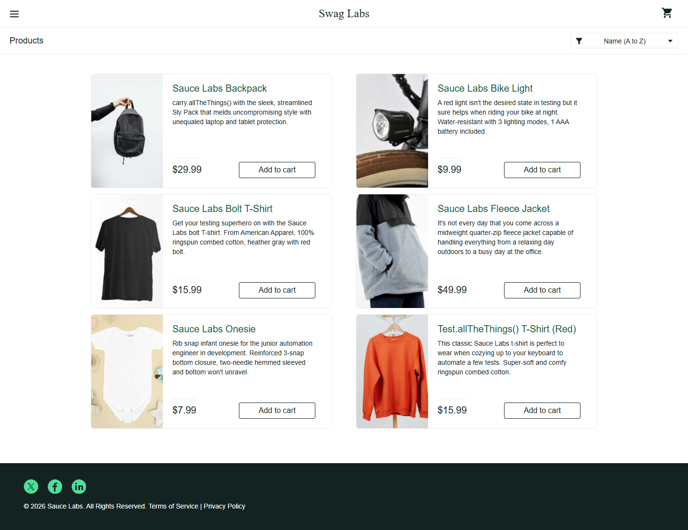
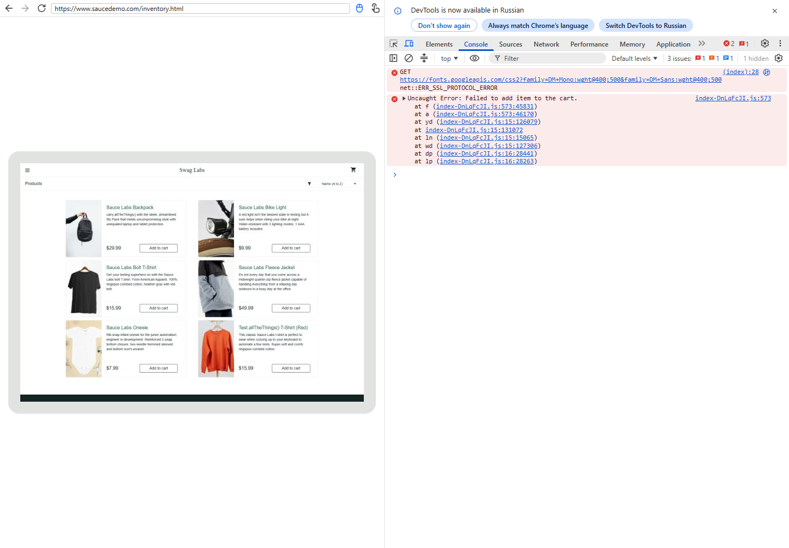
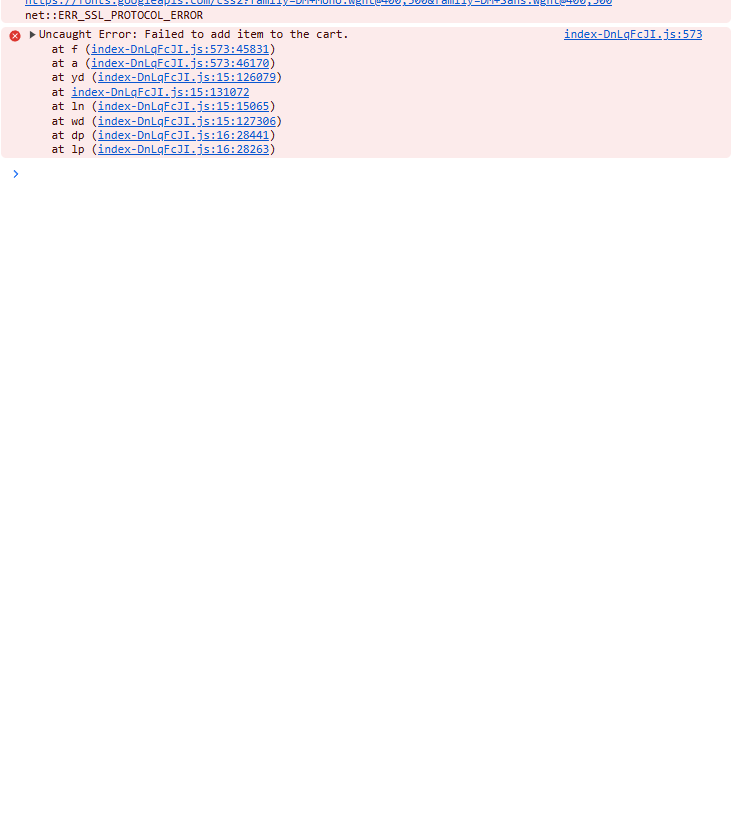

# ERR-01 — Кнопка Add to cart не добавляет Sauce Labs Bolt T-Shirt

## Описание дефекта
Кнопка Add to cart не добавляет Sauce Labs Bolt T-Shirt.

## Параметры
Аккаунт: error_user / secret_sauce.
Окружение: Windows-11-10.0.26200-SP0; Chrome 157.0.8103.52; 1440×1000.
Серьёзность: Major. Приоритет: High.
URL: https://www.saucedemo.com/inventory.html

## Шаги воспроизведения
1. Войти под error_user / secret_sauce.
2. Найти Sauce Labs Bolt T-Shirt.
3. Нажать Add to cart.

## Ожидаемый результат
Товар добавлен; кнопка меняется на Remove; счётчик корзины равен 1.

## Фактический результат
Кнопка остаётся Add to cart; счётчик корзины отсутствует: True. Ошибка добавления зафиксирована в журнале.

## Консоль
```text
Failed to add item to the cart.
```

## Доказательства



[Журнал консоли](../evidence/ERR-01_console.json)





Панель DevTools снята при повторном воспроизведении. Сообщение об ошибке загрузки Google Fonts относится к окружению; оно не объявляется причиной дефекта. Основной скриншот и исходный журнал относятся к первому воспроизведению.
