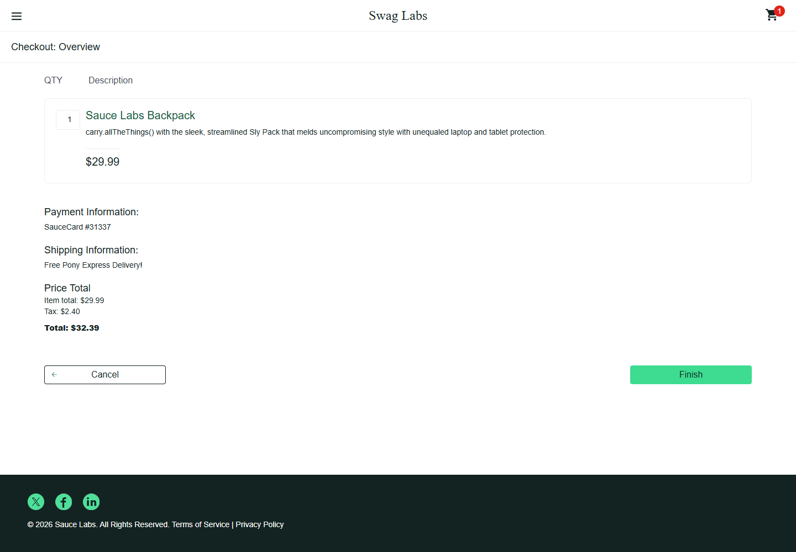
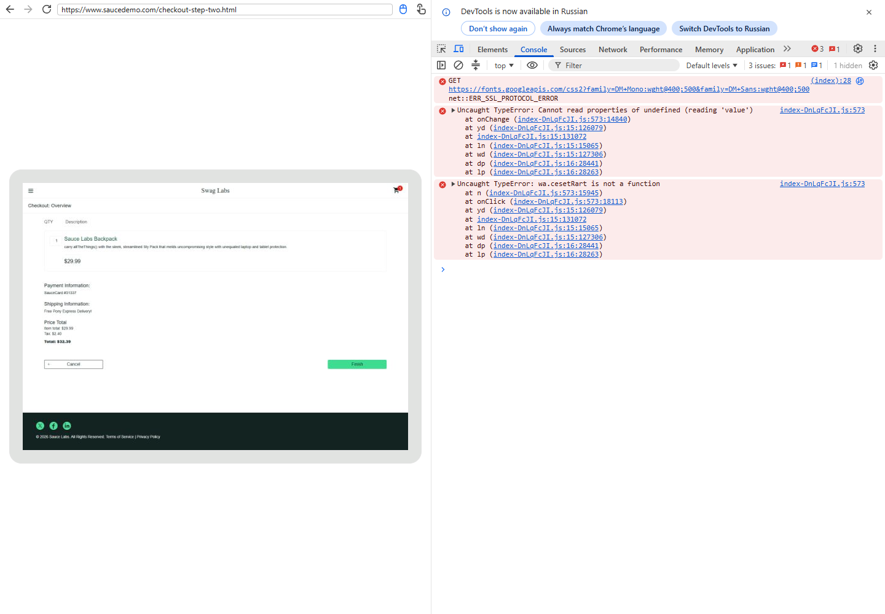
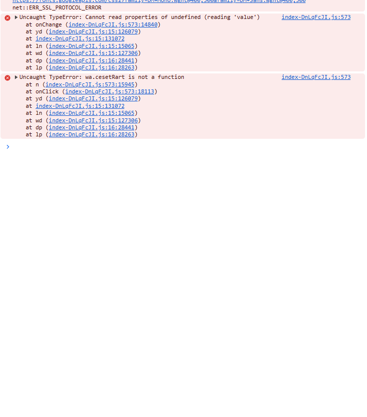

# ERR-02 — Finish не завершает оформление заказа

## Описание дефекта
Finish не завершает оформление заказа.

## Параметры
Аккаунт: error_user / secret_sauce.
Окружение: Windows-11-10.0.26200-SP0; Chrome 157.0.8103.52; 1440×1000.
Серьёзность: Critical. Приоритет: High.
URL: https://www.saucedemo.com/checkout-step-two.html

## Шаги воспроизведения
1. Войти под error_user / secret_sauce.
2. Добавить Sauce Labs Backpack и открыть корзину.
3. Нажать Checkout.
4. Ввести Yan, Len, 123456 и нажать Continue (поле фамилии под этим аккаунтом остаётся пустым, но переход допускается).
5. На странице Checkout: Overview нажать Finish.

## Ожидаемый результат
Переход на checkout-complete.html и сообщение Thank you for your order!

## Фактический результат
После нажатия остаётся https://www.saucedemo.com/checkout-step-two.html; подтверждение отсутствует.

## Консоль
```text
wa.cesetRart is not a function
```

## Доказательства



[Журнал консоли](../evidence/ERR-02_console.json)





Панель DevTools снята при повторном воспроизведении. Сообщение об ошибке загрузки Google Fonts относится к окружению; оно не объявляется причиной дефекта. Основной скриншот и исходный журнал относятся к первому воспроизведению.
