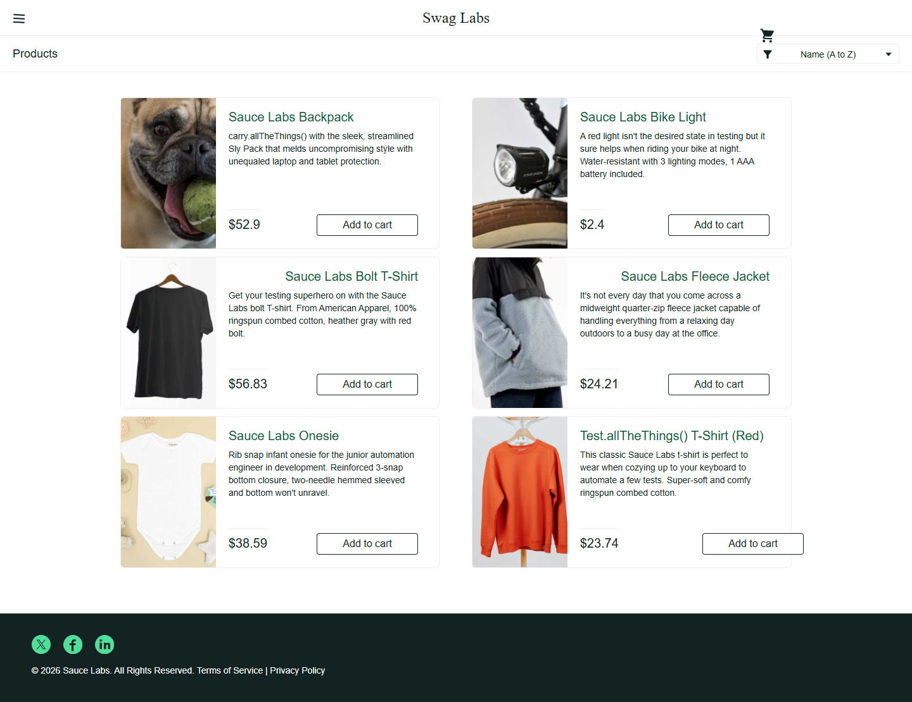
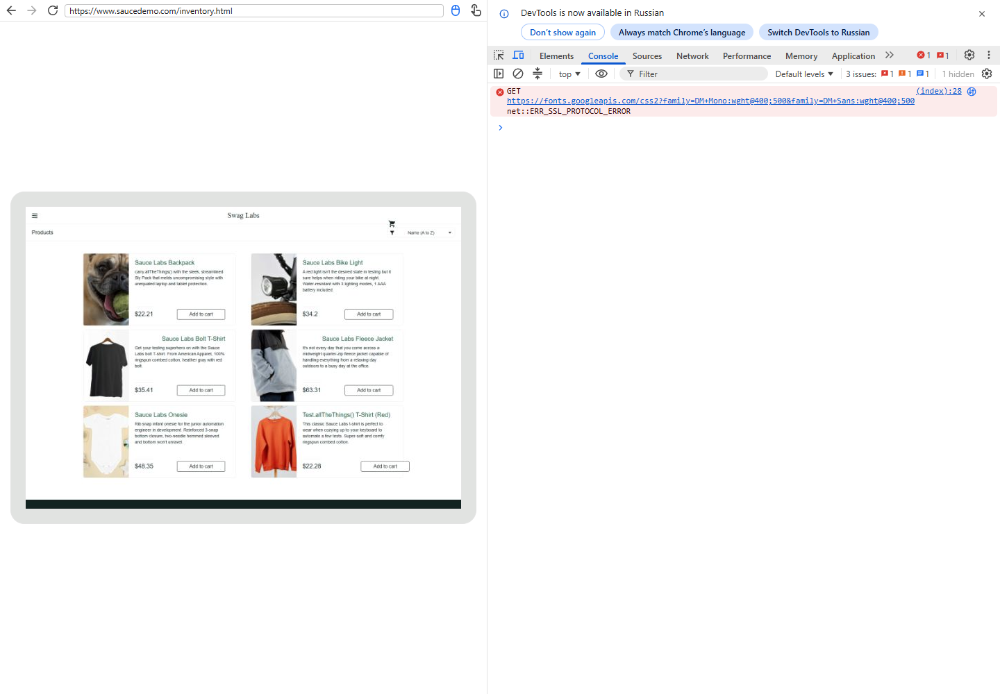
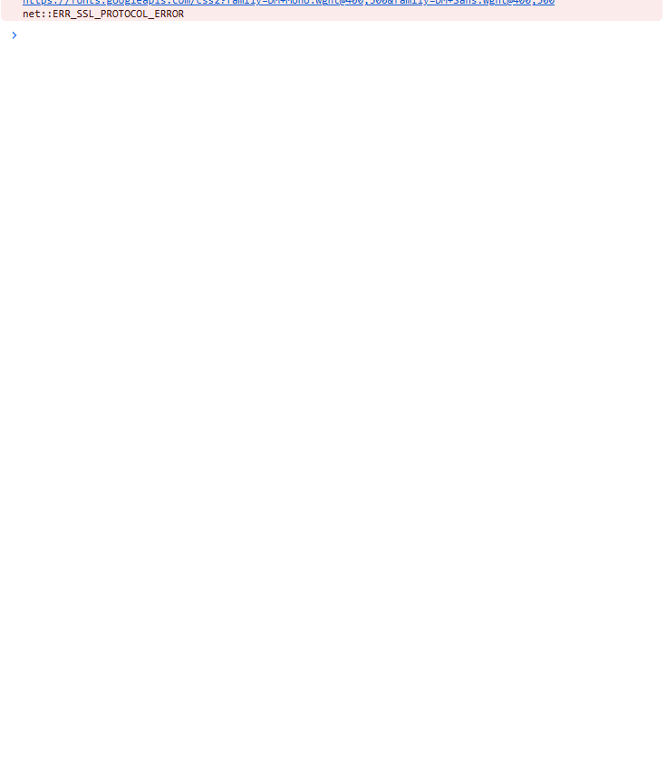

# VIS-01 — Значок корзины смещён из правого верхнего угла

## Описание дефекта
Значок корзины смещён из правого верхнего угла.

## Параметры
Аккаунт: visual_user / secret_sauce.
Окружение: Windows-11-10.0.26200-SP0; Chrome 157.0.8103.52; 1440×1000.
Серьёзность: Minor. Приоритет: Medium.
URL: https://www.saucedemo.com/inventory.html

## Шаги воспроизведения
1. Открыть сайт при размере окна 1440×1000.
2. Войти под visual_user / secret_sauce.
3. Сравнить положение корзины с standard_user при том же размере окна.

## Ожидаемый результат
Корзина находится в правом верхнем углу шапки, как в контрольном аккаунте.

## Фактический результат
Контрольный bounding box: {'x': 1380, 'y': 10, 'width': 40, 'height': 40}; visual_user: {'x': 1193.980712890625, 'y': 38.980690002441406, 'width': 42.03857421875, 'height': 42.03861999511719}. Значок смещён в область фильтра сортировки.

## Консоль
```text
Исключения JavaScript при данном сценарии не зафиксированы. Визуальное расхождение подтверждается скриншотом; отсутствие исключения не опровергает дефект.
```

## Доказательства



[Журнал консоли](../evidence/VIS-01_console.json)





Панель DevTools снята при повторном воспроизведении. Сообщение об ошибке загрузки Google Fonts относится к окружению; оно не объявляется причиной дефекта. Основной скриншот и исходный журнал относятся к первому воспроизведению.
