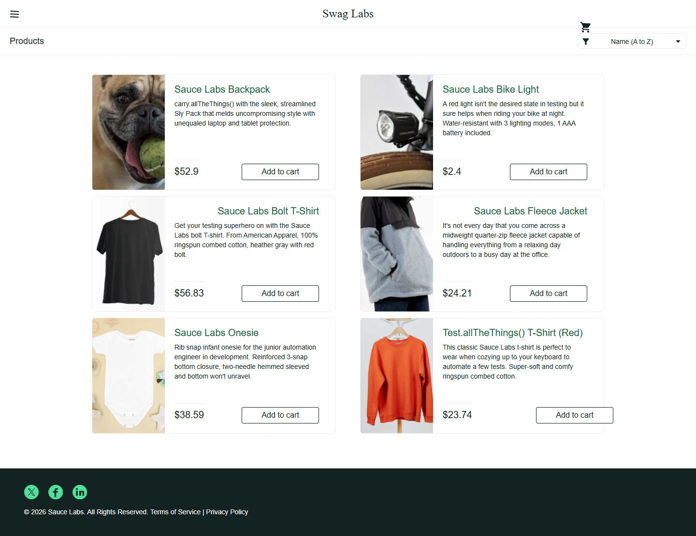
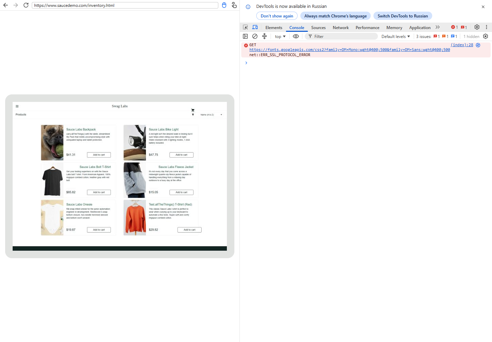
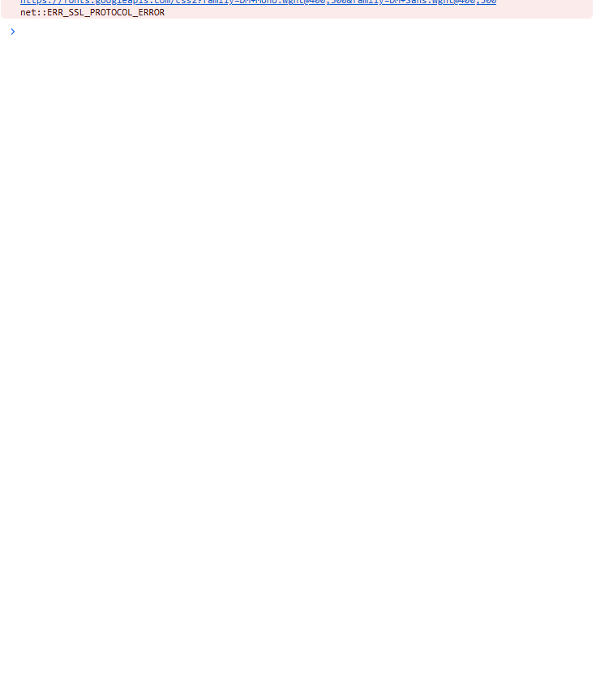

# VIS-02 — Кнопка последнего товара выходит за границы карточки

## Описание дефекта
Кнопка последнего товара выходит за границы карточки.

## Параметры
Аккаунт: visual_user / secret_sauce.
Окружение: Windows-11-10.0.26200-SP0; Chrome 157.0.8103.52; 1440×1000.
Серьёзность: Minor. Приоритет: Medium.
URL: https://www.saucedemo.com/inventory.html

## Шаги воспроизведения
1. Войти под visual_user / secret_sauce.
2. Оставить сортировку Name (A to Z).
3. Найти карточку Test.allTheThings() T-Shirt (Red).
4. Сравнить кнопку Add to cart с карточками и контрольным аккаунтом.

## Ожидаемый результат
Кнопка размещена внутри своей карточки и выровнена с другими кнопками.

## Фактический результат
Контрольный bounding box кнопки: {'x': 1055, 'y': 843, 'width': 160, 'height': 34}; visual_user: {'x': 1109, 'y': 843, 'width': 160, 'height': 34}. Кнопка смещена вправо за пределы карточки.

## Консоль
```text
Исключения JavaScript при данном сценарии не зафиксированы. Визуальное расхождение подтверждается скриншотом; отсутствие исключения не опровергает дефект.
```

## Доказательства



[Журнал консоли](../evidence/VIS-02_console.json)





Панель DevTools снята при повторном воспроизведении. Сообщение об ошибке загрузки Google Fonts относится к окружению; оно не объявляется причиной дефекта. Основной скриншот и исходный журнал относятся к первому воспроизведению.
