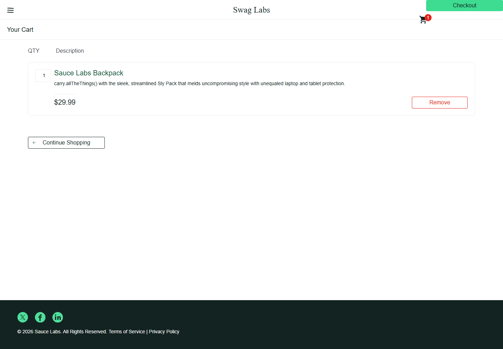
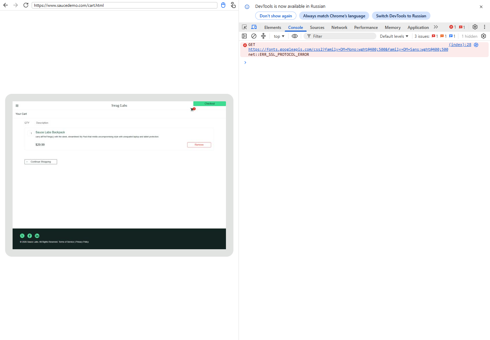
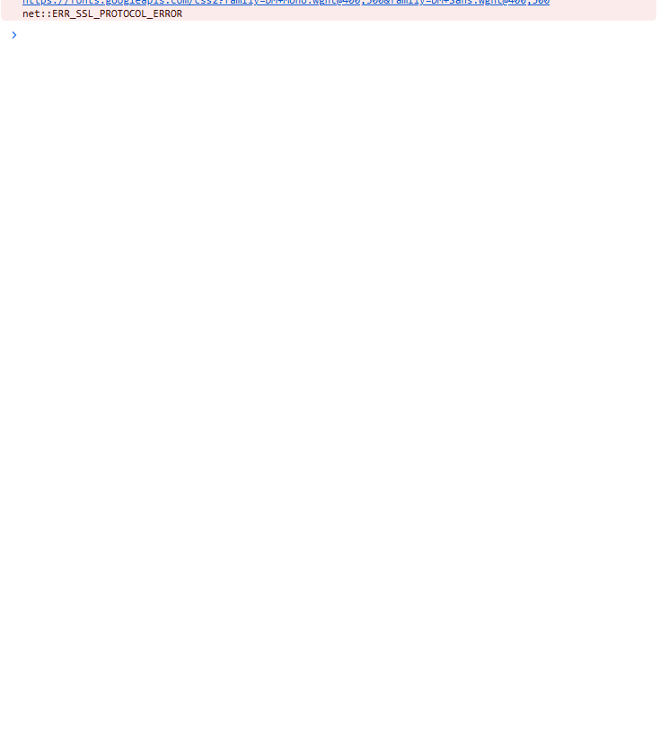
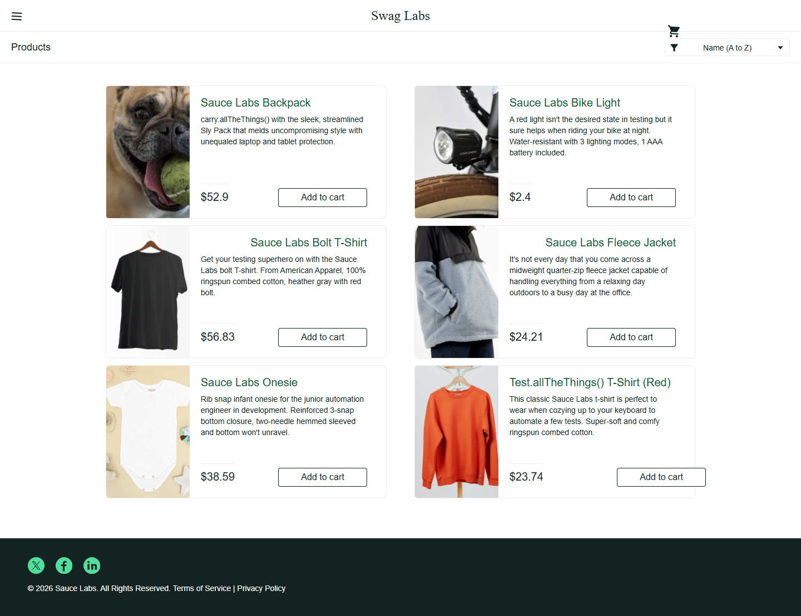

# VIS-03 — Цена товара в каталоге не совпадает с ценой в корзине

## Описание дефекта
Цена товара в каталоге не совпадает с ценой в корзине.

## Параметры
Аккаунт: visual_user / secret_sauce.
Окружение: Windows-11-10.0.26200-SP0; Chrome 157.0.8103.52; 1440×1000.
Серьёзность: Major. Приоритет: High.
URL: https://www.saucedemo.com/cart.html

## Шаги воспроизведения
1. Войти под visual_user / secret_sauce.
2. Зафиксировать цену Sauce Labs Backpack в каталоге.
3. Добавить этот товар и открыть корзину.
4. Сравнить цены одного товара.

## Ожидаемый результат
Цена одного и того же товара совпадает в каталоге и корзине без уведомления о пересчёте.

## Фактический результат
Каталог: $52.9; корзина: $29.99.

## Консоль
```text
Исключения JavaScript при данном сценарии не зафиксированы. Визуальное расхождение подтверждается скриншотом; отсутствие исключения не опровергает дефект.
```

## Доказательства



[Журнал консоли](../evidence/VIS-03_console.json)







Панель DevTools снята при повторном воспроизведении. Сообщение об ошибке загрузки Google Fonts относится к окружению; оно не объявляется причиной дефекта. Основной скриншот и исходный журнал относятся к первому воспроизведению.
